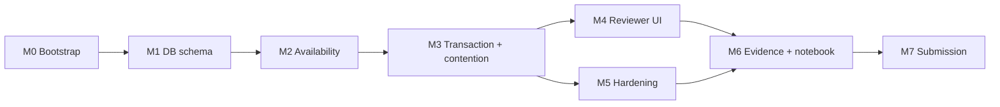

# KEYLOOP SCENARIO A — UNIFIED SERVICE SCHEDULER
## IMPLEMENTATION PLAN / EXECUTION RUNBOOK

**Ngày:** 2026-10-09  
**Version:** v1.0  
**Trạng thái:** PLANNED — chưa triển khai/chưa test  
**Tài liệu đi kèm:** `KEYLOOP-SCENARIO-A-SYSTEM-DESIGN-2026-10-09.md`.

---

## 0. Mục tiêu thực thi

Xây dựng Scenario A theo nguyên văn ba acceptance criteria của Keyloop: đặt lịch theo vehicle/service/dealership/thời gian; kiểm tra đồng thời ServiceBay và **qualified** Technician cho **toàn bộ duration**; lưu Appointment gắn customer/vehicle/technician/bay. Chọn backend là service layer cần hoàn thiện đầy đủ; frontend Vue vẫn phải hoạt động thực tế để reviewer thao tác nhanh.

### Ràng buộc công nghệ bắt buộc

- **Backend:** Node.js (JavaScript ESM) + **Hono** và `@hono/node-server`.
- **Database:** SQLite3 file thực, qua **better-sqlite3**; có migrations, constraints, indexes, triggers và transaction.
- **Frontend:** **Vue 3** qua browser-native ES modules CDN + **Tailwind CSS v4 Play CDN**; HTML/JS/CSS tĩnh; **không** Vite / Webpack / Rollup / Parcel / Nuxt / Vue CLI.
- **Không Docker** và không Google Drive mount; có thể chạy local Linux hoặc Kaggle `/kaggle/working`.
- **Một HTTP port duy nhất**: Hono vừa phục vụ frontend tĩnh vừa phục vụ JSON REST API.
- **Không** tự nhận PASS nếu chưa chạy và kiểm tra chứng cứ.

### Definition of Done (DoD) toàn dự án

- 3/3 acceptance criteria Keyloop được chứng minh bằng API, persisted rows và UI.
- Xử lý an toàn ít nhất hai requests tranh cùng Technician hoặc ServiceBay, có test **multi-process với hai SQLite connections độc lập**.
- Tất cả unit/integration/concurrency tests cần thiết đều PASS qua execution thực tế.
- Có dữ liệu seed synthetic, chạy được từ clean install và giữ SQLite khi restart.
- Frontend no-build hoạt động ở cùng URL với API, bao gồm error handling/409 stale slot.
- Hoàn tất SDD, README (có AI Collaboration Narrative), API examples, testing report, reviewer guide và video 5–10 phút.
- Không commit token, config bí mật, live production data hoặc DB chứa dữ liệu cá nhân thật.

---

## 1. Layout repository đề xuất

```text
Keyloop-Scenario-A-Unified-Service-Scheduler/
├── README.md
├── package.json
├── package-lock.json
├── .gitignore
├── .env.example
├── public/
│   ├── index.html                    # Vue browser ESM + Tailwind CDN
│   ├── css/app.css                  # minimal custom CSS (if required)
│   ├── js/main.js                   # Vue createApp, route/view bootstrap
│   ├── js/api.js                    # fetch wrapper, errors, request id
│   ├── js/components/              # plain .js modules with templates
│   └── assets/                     # owned local icons/graphics
├── src/
│   ├── server.js                    # Hono Node HTTP listener
│   ├── app.js                       # Hono app factory, middleware, routes
│   ├── config.js                    # validated environment
│   ├── db/
│   │   ├── connection.js            # sqlite pragmas, connection lifecycle
│   │   ├── migrations/
│   │   │   └── 001_initial.sql
│   │   ├── migrate.js               # schema_migrations registry
│   │   ├── seed.js                  # deterministic synthetic demo seed
│   │   ├── appointment.repo.js
│   │   └── availability.repo.js
│   ├── domain/
│   │   ├── availability.service.js
│   │   ├── booking.service.js
│   │   ├── cancellation.service.js
│   │   ├── time.js                  # dealership timezone policy
│   │   └── errors.js
│   ├── routes/
│   │   ├── reference.routes.js
│   │   ├── availability.routes.js
│   │   └── appointments.routes.js
│   ├── middleware/
│   │   ├── observability.js
│   │   ├── errors.js
│   │   └── demo-write-auth.js
│   └── validation/
│       └── schemas.js
├── tests/
│   ├── fixtures.js
│   ├── availability.test.js
│   ├── booking.test.js
│   ├── routes.test.js
│   ├── cancellation.test.js
│   ├── persistence.test.js
│   ├── concurrency.test.js
│   └── workers/booking-worker.cjs   # independent child processes
├── scripts/
│   ├── smoke.sh
│   ├── reviewer-evidence.js
│   ├── backup.js
│   └── verify-backup.js
├── data/                              # SQLite persistent runtime; gitignored
├── evidence/                          # generated; sanitized prior to publish
└── docs/
    ├── SYSTEM-DESIGN.md
    ├── IMPLEMENTATION-PLAN.md
    ├── API.md
    ├── REVIEWER-GUIDE.md
    ├── TEST-EVIDENCE.md
    ├── AI-COLLABORATION-NARRATIVE.md
    └── VIDEO-SCRIPT.md
```

`src/server.js` exposes Hono routes and serves static assets from an **absolute path resolved from `import.meta.url`**, avoiding CWD-dependent bugs when launched from Kaggle/Jupyter.

## 2. Package commands / bootstrap

Proposed packages:

```bash
npm install hono @hono/node-server better-sqlite3 luxon zod
```

Proposed `package.json` scripts (to be created, not yet existing):

```json
{
  "type": "module",
  "scripts": {
    "dev": "node --watch src/server.js",
    "start": "node src/server.js",
    "db:migrate": "node src/db/migrate.js",
    "db:seed": "node src/db/seed.js",
    "test": "node --test tests/*.test.js",
    "test:concurrency": "node --test tests/concurrency.test.js",
    "smoke": "bash scripts/smoke.sh",
    "evidence": "node scripts/reviewer-evidence.js",
    "backup": "node scripts/backup.js"
  }
}
```

**Environment example** (names only; no real secrets):

```dotenv
NODE_ENV=development
PORT=3000
HOST=0.0.0.0
DATABASE_PATH=./data/scheduler.sqlite
LOG_LEVEL=info
SLOT_STEP_MINUTES=30
BOOKING_LOOKAHEAD_DAYS=30
SQLITE_BUSY_TIMEOUT_MS=5000
DEMO_WRITE_TOKEN=
```

When `HOST=0.0.0.0` and exposed via a tunnel, require an appropriate demo write token or disable mutation; do not hard-code credentials in browser bundle. On a developer's localhost, no token may be configured only when explicitly allowed by configuration. Keep `data/`, `.env`, token files and secret artifacts in `.gitignore`.

**Node version gate:** Verify actual Node and `better-sqlite3` native-addon compatibility on target machine in M0; use a supported LTS line, avoid claiming a specific version is installed before checking.

---

## 3. Milestones, required tasks and gates

### M0 — Requirement lock, clean environment and repository skeleton

**Actions**

1. Reconfirm acceptance criteria A-1/A-2/A-3 and submission format from the provided assessment.
2. Create independent Scenario A repository; do not overwrite or mix with completed Scenario D files.
3. Check `node -v`, `npm -v`, target filesystem, `better-sqlite3` install/load and effective SQLite version.
4. Pin tested Vue browser ESM and Tailwind browser CDN URLs to exact usable versions (browser check: network + console).
5. Create directory layout, Hono hello-world, static `index.html`, `.gitignore`, `.env.example`, npm scripts.
6. Start Node on `PORT` and verify `/`, `/healthz`, `/readyz` using HTTP tools.

**Gate M0:** Hono server serves browser-readable Vue + Tailwind static page and JSON health route on one port, with no frontend build command; source tracked by Git. Evidence: package versions, `curl`, browser console screenshot/log.

### M1 — SQLite schema, migrations, seed and backup baseline

**Actions**

1. Implement relational schema from SDD: dealerships, dealership hours, customers, vehicles, service types, skills, technician skills/shifts, bays/service capabilities, blackouts, appointments.
2. Add FK, CHECK, UNIQUE, partial indexes, no-overlap triggers for both INSERT and UPDATE.
3. Set `foreign_keys=ON`, WAL, busy timeout and tested durability choice; migration version registry.
4. Create deterministic synthetic fixture: >=2 dealers, >=3 services with different durations, multiple tech skills, >=3 bays, shifts/lunch break, blackouts, pre-existing appointments and vehicle/customer relationships.
5. Add safe idempotent seeding that never silently resets a real existing appointment DB.
6. Test persistent DB by process restart; create backup using SQLite backup API; verify restore and `PRAGMA integrity_check`.

**Gate M1:** Migration from empty file PASS; foreign keys/triggers PASS; seed repeat safe; restart and backup/restore preserve records. Evidence includes schema version + fixture manifest, no private data.

### M2 — Availability engine and API

**Actions**

1. Implement time parser with dealership IANA timezone checks and `[start,end)` semantics.
2. Resolve service duration from DB; check dealer hours and full shift; reject invalid or DST ambiguous/nonexistent inputs.
3. Filter qualified technicians requiring **all** service skills, correct dealer, active and not in blackout.
4. Filter compatible bays, correct dealer, active and not in blackout.
5. Use indexed overlap checks on confirmed appointments for each resource; require at least one eligible pair.
6. Enumerate 30-minute slots for selected date, bounded query horizon; expose `/api/v1/availability` and basic reference-data endpoints.
7. Add unit tests including partial overlap, boundary-touch, blackouts, skill mismatch and zero available resources.

**Gate M2:** Sample date yields correct free slots and negative cases return none; **full duration** is proven by tests, not inferred from a start-time-only check.

### M3 — Atomic booking, cancellation, idempotency and concurrency proof

**Actions**

1. Implement `POST /appointments` with schema validation, demo auth, request fingerprint and required `Idempotency-Key`.
2. Use synchronous `better-sqlite3` transaction invoked as `.immediate(...)` to recheck availability **inside** transaction and persist exactly one assigned technician/bay pair.
3. Handle conflicts (`409`), invalid ownership (`422`), SQLite busy (`503` after bounded retry) and unknown errors (sanitized `500`).
4. Implement `GET /appointments/:id`, list filters and cancel preserving historical row.
5. Verify overlap INSERT/UPDATE triggers independently by raw SQL.
6. Build **multi-process** test harness with separate SQLite connections and synchronized start; compare results **and query DB directly** after requests.
7. Verify idempotent replay (same request) and key mismatch (different payload), cancellation/rebooking, process restart persistence.
8. Capture machine-readable test report and anonymized request logs.

**Gate M3:** `npm test` + multi-process test PASS with no confirmed overlap and no partial writes. A failed concurrency test blocks proceeding to reviewer UI; do not relabel failure as pass.

### M4 — Frontend Vue 3 + Tailwind browser CDN (strict no-build)

**Actions**

1. `public/index.html` with Vue browser ESM import map and Tailwind browser CDN, both URLs tested and pinned.
2. Component modules are **plain JS** with Vue `setup()` + inline `template` (or `render()`), no `.vue` files or transpilation.
3. Booking form: dealer, existing synthetic customer, vehicle, service, date, available slot, confirm.
4. Availability loading skeleton, empty state and local-timezone label; stale slot `409` refresh path.
5. Booking confirmation showing persisted appointment technician/bay and clear appointment ID.
6. Appointment history/details and cancellation action; recover UI after reload.
7. Accessibility: labels, keyboard navigation, focus, contrast, error alerts, responsive mobile.
8. Manual browser smoke: network requests show same-origin `/api/v1`, Tailwind works, no ESM import or CSP errors.

**Gate M4:** Reviewer can complete end-to-end booking from browser without building frontend, and observe a conflict/retry UX. Evidence: browser inspection, screenshots, accessibility checklist.

### M5 — Observability, fault cases and operational hardening

**Actions**

1. Request IDs and structured route timings; booking outcome/error logs with redaction.
2. Bound API input, pagination and availability horizon; use parameterized queries; ensure no leaked stack trace/credentials.
3. Validate cancellation, repeat booking and `SQLITE_BUSY` behavior under targeted tests.
4. Add `/healthz`, `/readyz`, correct shutdown and reopen behavior; document WAL/native SQLite caveats.
5. Capture observed latency and counters; report facts only, no invented benchmark numbers.
6. Ensure no public writes if demo token is absent on exposed server; preserve synthetic fixture.

**Gate M5:** Logs demonstrate search → booking → conflict → cancellation with request IDs; privacy/security checks pass; health/restart/persistence verified.

### M6 — Reviewer packaging, evidence and Kaggle notebook (optional delivery enhancer)

**Actions**

1. Complete README: business scope, stack rationale, architecture quick view, clean install, run, test, troubleshooting, demo URL policy, reviewer flow and **AI Collaboration Narrative**.
2. Copy finalized SDD/implementation plan into `docs/`; produce compact `API.md` and `REVIEWER-GUIDE.md`.
3. Add reproducible `npm run evidence` that reports migration/version, synthetic seed, availability case, successful booking, rejected conflicting booking, stored assignment and concurrency-test summary.
4. Write notebook steps for Kaggle (if deployed there): setup Node, restore repository, initialize DB without losing existing data, run server, launch tunnel externally, `curl` API, run tests and display JSON evidence.
5. Save source + sanitized evidence as portable archive before Kaggle restart. Backup SQLite transactionally (not `cp` live `.sqlite` in WAL mode).
6. Inspect Git status, no real tokens, PAT, `.env`, sqlite runtime DB or user PII; check README commands from clean checkout.

**Gate M6:** Fresh checkout bootstraps successfully; reviewer can repeat core checks; all published artifacts consistent with actual observed results.

### M7 — Submission and presentation

**Actions**

1. Produce 5–10 minute video including: introduction/scenario, architecture, implementation focus, AI collaboration **1–2 minutes**, running browser demo and lessons learned.
2. Show compelling scenario: 2 concurrent requests for same slot → exactly one confirmed resource pair, plus persistent DB proof; avoid calling a synthetic scripted output real traffic unless it ran.
3. Include design tradeoff: SQLite one writer, transactional booking, no-build Vue/CDN; acknowledge Tailwind CDN production caveat.
4. Final public repo quality checks, source ZIP/manifest, screenshots, sanitized logs, test report and submission link(s).

**Gate M7:** Three Keyloop artifacts ready: system design, Git working code with README/tests/AI narrative, and 5–10 minute video. Do not claim a multi-scenario submission satisfies the single-scenario instruction without authorization.

---

## 4. Dependency order (critical path)



**Không** phát triển trang UI đẹp để che lấp lỗi concurrency; M3 là gating milestone. M4/M5 có thể triển khai song song sau M3 nếu có môi trường hoặc nhân lực phù hợp.

## 5. Detailed acceptance checklist (traceable)

### A-1 — Resource-constrained request

- [ ] API bắt buộc `customerId`, `vehicleId`, `dealershipId`, `serviceTypeId`, `startAt` có timezone offset.
- [ ] Frontend cho chọn đúng 4 thành phần thông tin Keyloop yêu cầu và customer liên quan.
- [ ] Server từ chối thiếu trường, thời gian quá khứ hoặc xe không thuộc customer.
- [ ] Dealer timezone hiển thị rõ trong UI và phản hồi API.

### A-2 — Real-time dual-resource availability

- [ ] Thời lượng đọc từ bảng service type.
- [ ] Một Technician phải đúng dealership và sở hữu **tất cả** required skills.
- [ ] Một ServiceBay phải đúng dealership và tương thích service.
- [ ] Cả hai đều rảnh **toàn bộ** `[start,end)`, không nằm trong blackout, và technician đang trong full shift.
- [ ] Availability được kiểm tra lại trong transaction khi submit, không tin preview.
- [ ] Kiểm thử technician-busy-only, bay-busy-only, exact-boundary, partial overlap, blackouts.

### A-3 — Confirmed persistent record

- [ ] `appointments` có FK tới customer, vehicle, dealership, service type, technician, bay.
- [ ] `201` trả assigned IDs; DB row giống payload và duration chuẩn.
- [ ] No double-booking khi gọi từ nhiều processes.
- [ ] Sau restart, appointment truy vấn được và status chuẩn.
- [ ] Cancel chỉ chuyển status và giải phóng slot; không phá lịch sử.

## 6. Suggested test commands and reviewer walkthrough

Commands below are **future commands after implementation**, not a claim the files already exist:

```bash
# Run from repository root
npm ci
npm run db:migrate
npm run db:seed
npm test
npm run test:concurrency
npm run smoke
npm run evidence
npm run start
```

Reviewer walkthrough:

1. Open `/` and confirm Vue/Tailwind asset loads (no Vite/SPA dev server).
2. Select seeded dealership and service; see how duration affects available slots.
3. Book a free slot; inspect confirmation with customer/vehicle/technician/bay and time.
4. Replay same request with same `Idempotency-Key` → original appointment, no duplicate row.
5. Race two fresh request IDs from **independent processes** to one slot; show DB query + test report confirming invariant.
6. Cancel the original appointment and create a new booking into the released slot.
7. Restart Node; demonstrate that appointments persist, and show structured request logs.

Proposed `curl` contract example (IDs/dates **synthetic**, adapt to real fixture values):

```bash
curl -sS 'http://127.0.0.1:3000/api/v1/availability?dealershipId=dlr_001&serviceTypeId=svc_oil&date=2026-10-12' | jq .

curl -sS -i -X POST 'http://127.0.0.1:3000/api/v1/appointments' \
  -H 'Content-Type: application/json' \
  -H 'Idempotency-Key: manual-demo-001' \
  -d '{"customerId":"cus_001","vehicleId":"veh_001","dealershipId":"dlr_001","serviceTypeId":"svc_oil","startAt":"2026-10-12T09:00:00+07:00"}'
```

When using an authenticated public demo, append `-H "X-Demo-Write-Token: ${DEMO_WRITE_TOKEN}"` locally; **never record that token** in published logs/video. Select a **future** seeded date at execution time rather than relying on the historical example date.

## 7. Test evidence schema

Write an evidence report such as `evidence/acceptance-report.json` containing:

```json
{
  "scenario": "A",
  "generatedAt": "<actual execution time>",
  "gitCommit": "<actual commit>",
  "nodeVersion": "<verified runtime>",
  "sqliteVersion": "<verified sqlite version>",
  "databaseIntegrity": "<measured result>",
  "tests": {
    "unit": "NOT_RUN",
    "integration": "NOT_RUN",
    "concurrencyMultiProcess": "NOT_RUN",
    "persistenceRestart": "NOT_RUN",
    "frontendManual": "NOT_RUN"
  },
  "invariants": {
    "noOverlappingConfirmedTechnician": "NOT_RUN",
    "noOverlappingConfirmedServiceBay": "NOT_RUN"
  },
  "reportFiles": []
}
```

Update only from actual command outputs. A test `FAIL` stays `FAIL` even if later tests pass; keep failure diagnostics and subsequent retry history.

## 8. Kaggle operational notes

Suggested base directory (only if Kaggle is chosen):

```bash
export PROJECT_ROOT=/kaggle/working/keyloop-scheduler
export DATABASE_PATH="$PROJECT_ROOT/data/scheduler.sqlite"
export PORT=3000
```

- `better-sqlite3` needs a native addon compatible with active Node runtime. Preflight its load and SQLite version before committing to setup.
- Kaggle sessions may restart; **source, DB backup, migrations, evidence and config template** go under durable `/kaggle/working`, not `/tmp`.
- If a public URL is desired, start tunnel separately from Node. Do not assume a tunnel exposes HTTP 200 until tested from an external browser.
- Do not install Docker or demand a Google Drive mount.
- Before stopping machine, produce source archive and consistent SQLite online backup; test manifest hashes and restore scenario.
- A Kaggle notebook is **optional reviewer evidence**, not a formal requirement in Keyloop text.

## 9. Risks & mitigations

| Risk | Impact | Mitigation |
|---|---|---|
| Check availability before transaction only | Double booking | Recheck and insert in `BEGIN IMMEDIATE`; DB overlap triggers |
| Single-process only concurrency test | False PASS | Independent child processes and DB connections |
| `SQLITE_BUSY` under contention | Failed booking | Busy timeout + bounded retry; honest `503` |
| SQLite WAL on network FS | Locking/consistency limitations | Store DB on local machine filesystem |
| Native `better-sqlite3` binary mismatch | Setup failure | M0 Node/ABI preflight, supported LTS versions |
| Dates misinterpreted across timezone/DST | Incorrect reservation | Dealer IANA zone, explicit offset, invalid/ambiguous time tests |
| Vue SFC or npm-only imports used in browser | Frontend fails without build | JS ESM CDN + import map; no `.vue`, no bundler |
| Tailwind CDN interpreted as production-ready | Incorrect claim | Document development-only CDN and future migration |
| CDN inaccessible | Blank/un-styled reviewer page | Browser preflight, clear network prerequisites; keep API and tests independent |
| No auth on public tunnel | Unauthorized modifications | Demo write token or public read-only mode; synthetic data only |
| Live SQLite copied in WAL mode | Inconsistent backup | Online backup API + restore + integrity check |
| AI-generated code 'looks correct' without evidence | False confidence | Test-first gates, independent negative/concurrency tests, AI collaboration log |

## 10. AI collaboration narrative: evidence to capture as work proceeds

- Requirement briefing supplied to AI (exact Scenario A requirements, chosen stack and constraints).
- Design alternatives discussed and rationale (SQLite locking, app-level vs DB-level overlap protections, no-build Vue architecture).
- Each significant AI-proposed change: task, prompt summary, changed files, verification command, observed outcome and correction, if any.
- Counterexamples where AI output initially failed (e.g., stale preview, overlapping bookings, timezone issues) and how human evaluation caught them.
- Human ownership of final run/test/video, with verifiable commits and sanitized evidence.

Do not turn hypothetical interactions in this plan into retrospective claims. Actual `AI Collaboration Narrative` must be filled from genuine development records.

## 11. Milestone status board

| Milestone | Current status | Evidence |
|---|---|---|
| M0 Environment and skeleton | NOT_STARTED | None |
| M1 DB schema and backup | NOT_STARTED | None |
| M2 Availability | NOT_STARTED | None |
| M3 Booking + multi-process concurrency | NOT_STARTED | None |
| M4 Vue no-build UI | NOT_STARTED | None |
| M5 Hardening | NOT_STARTED | None |
| M6 Reviewer docs / notebook | NOT_STARTED | None |
| M7 Submission video | NOT_STARTED | None |

**Next action:** Implement M0 first, inspect real environment and log results. Do not overwrite Scenario D. Proceed to M1 only after M0 gate passes.

## 12. Reference material

- User-provided `KeyloopCodingChallange.md` — Scenario A, structure and submission framework.
- `KEYLOOP-SCENARIO-A-SYSTEM-DESIGN-2026-10-09.md` — architecture, policy, detailed test cases and API contract.
- https://hono.dev/docs/getting-started/nodejs
- https://vuejs.org/guide/quick-start
- https://tailwindcss.com/docs/installation/play-cdn
- https://www.sqlite.org/lang_transaction.html
- https://www.sqlite.org/wal.html
- https://github.com/WiseLibs/better-sqlite3/blob/master/docs/api.md
