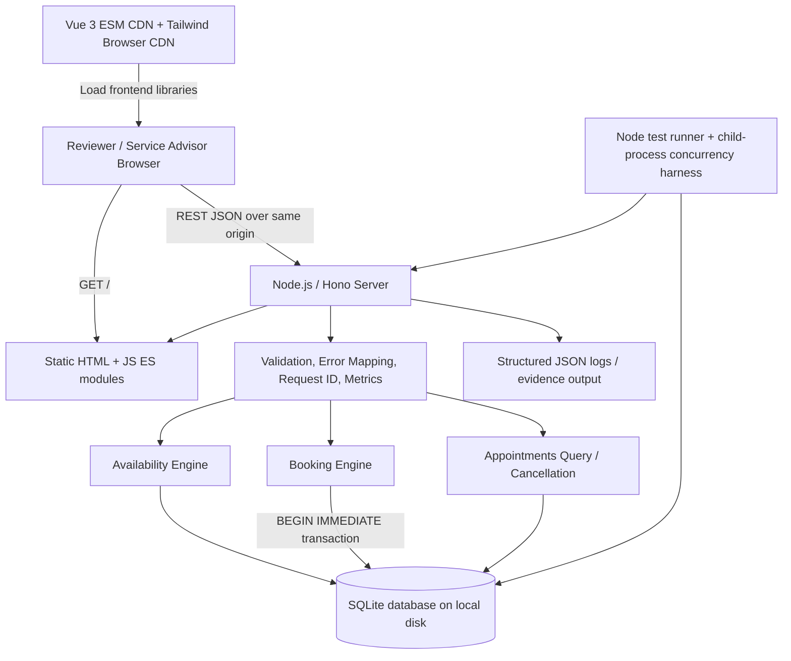
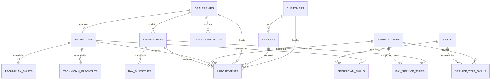

# Keyloop Scenario A — The Unified Service Scheduler
## System Design Document (SDD)

**Version:** 1.0 — 2026-10-09  
**Status:** DESIGN PROPOSAL / NOT YET IMPLEMENTED OR TESTED  
**Scenario:** A — Ownership — The Unified Service Scheduler  
**Implementation focus:** Production-minded **backend service**, supplemented by a functional **no-build Vue.js reviewer UI**.  
**Required stack:** Node.js + Hono; SQLite3; Vue.js 3 + Tailwind CSS browser CDN; **no frontend build tools**.

> **Scope note:** The Keyloop assessment asks the candidate to choose ONE scenario and fully implement either the backend or the frontend. This project implements the backend thoroughly and adds an integrated frontend to improve reviewer experience. It does not claim that both service layers are required by Keyloop.

---

## 1. Source requirements and traceability

Based on `KeyloopCodingChallange.md`, Scenario A must:

| ID | Keyloop requirement | Proposed acceptance evidence |
|---|---|---|
| A-1 | User requests an appointment for a specific vehicle, service type, dealership and desired time | Booking form, `POST /api/v1/appointments`, positive/negative API tests |
| A-2 | Verify availability of **both** an appropriate ServiceBay **and a qualified Technician** for the **entire** service duration before confirming | Slot preview, qualification and interval tests, transaction and concurrency tests |
| A-3 | Persist an Appointment linking Customer, Vehicle, Technician and ServiceBay | Relational schema + foreign keys, API detail endpoint, restart/persistence test |

Submission also requires an architecture diagram, component roles, data flow, technology rationales, observability strategy, GenAI design-phase narrative, README, tests, a Git repository and a 5–10 minute presentation video. The following assumptions are **design choices**, not additional Keyloop requirements.

## 2. Goals, boundaries and documented assumptions

### In scope (MVP)

- One booking reserves **exactly one** qualified Technician and **exactly one** compatible ServiceBay for an entire interval.
- Multiple dealerships; a vehicle has exactly one owner for this demo; a booking is made for that owner.
- Service types have fixed durations and required technician skills; ServiceBays can support a subset of service types.
- Dealership opening hours, technician shifts and explicit unavailability periods are enforced.
- Search availability, create appointment, show appointment details, list appointments and cancel an appointment.
- Deterministic auto-assignment of an eligible technician/bay pair.
- Accurate handling of overlapping time intervals, concurrent requests and retries.
- Synthetic seed dataset, demo-ready responsive frontend, consistent errors, structured diagnostics, tests and reviewer evidence.

### Explicitly out of scope (unless promoted after core gates pass)

- External dealer-management integrations, payment, SMS/email notifications, live workforce scheduling, automatic rescheduling, multi-bay jobs, technician fractional capacity, recurring appointments, enterprise identity/SSO, distributed booking across multiple SQLite hosts.
- AI-powered scheduling or an LLM at runtime (GenAI use is in design and code collaboration/verification, not a core runtime dependency).

### Business assumptions

1. Booking requests must begin in the future and inside one dealership-local calendar day; service duration cannot cross closing time.
2. Daily operating hours and shifts are expressed in the **dealership's IANA time zone**; all persistent appointment boundaries are UTC epoch milliseconds.
3. Time intervals use **half-open** semantics `[start, end)` — an appointment finishing at 11:00 does not overlap one beginning at 11:00.
4. A request slot is generally aligned to a 30-minute step (configurable); duration is read from the trusted service-type record, **never from an arbitrary client value**.
5. Availability preview is advisory. Booking rechecks **all** conditions inside its write transaction.
6. Cancelled appointments release both resources but remain stored for audit/review.
7. API requests identify an existing seeded customer/vehicle. The UI uses only synthetic customer and vehicle records.
8. Appointment creation requires an `Idempotency-Key`; identical retries are safe, conflicting reuse is rejected.
9. Invalid or ambiguous/nonexistent local times around DST transitions are rejected; for normal dates, timezone conversion is performed server-side.
10. Public demo is read-only by default unless a write token is supplied. This is a demo safeguard, not a replacement for production authentication.

## 3. C4-style logical architecture



**Single-host, single-port deployment:** The same Hono process handles `/api/v1/*` and static frontend assets. No frontend dev server, bundler, Docker, Redis, message broker or separate DB server is required.

### Main components

| Component | Responsibility | Key guarantees |
|---|---|---|
| Browser UI | Dealer/service/vehicle selection, slot preview, booking, confirmation, appointment listing | Clear status, loading/error states, accessible forms |
| Hono HTTP adapter | REST routes, static files, request IDs, validation, error mapping, security | Stable JSON contract, same-origin UI |
| Availability engine | Check business hours, shifts, blackouts, technician skills, bay capabilities and existing bookings | No resource pair offered unless both qualify for **full interval** |
| Booking service | Recompute candidates, atomically confirm, enforce idempotency | No double-booked technician/bay |
| SQLite repository | SQL parameterization, migrations, indexes, transactions, triggers | Persistent relational integrity, defensible constraints |
| Test/evidence layer | Domain, route, persistence, multi-process contention, reviewer report | Verifiable PASS/FAIL artifacts — never predeclared success |

## 4. Technology decisions

| Layer | Choice | Rationale / tradeoff |
|---|---|---|
| Runtime | Supported Node.js LTS, ES modules (`"type":"module"`) | Small deployment footprint and native `node --test` |
| Web framework | `hono` + `@hono/node-server` | Minimal REST stack; static serving via adapter |
| SQLite driver | `better-sqlite3` (SQLite3 engine) | Prepared statements, explicit synchronous transactions, `.immediate()`; native binary install requires environment preflight |
| Storage | One **file-backed SQLite** database, WAL mode, foreign keys ON | Persistent, simple, zero separate DB server; **not** multi-host/shared-network-filesystem architecture |
| UI | Vue 3 browser ESM from CDN, `.js` modules with inline templates | Browser-native modules; no Vite/Webpack/SFC compilation |
| Styles | Tailwind v4 **Play CDN** + small handcrafted CSS | Meets requested zero-build setup; browser CDN is documented as **development-only**, so explicitly a demo tradeoff |
| Dates | `luxon` on server for IANA timezone/date validation | Distinguishes local dealership time from UTC; test DST cases |
| Tests | `node:test`, `node:assert`, `child_process` | No additional test bundler; true independent SQLite connections/processes |
| Observability | JSON logs, lightweight request metrics, evidence script | Reviewer-friendly and low-dependency |

**CDN constraints:** The Vue ESM production browser build must be loaded over HTTP(S), not `file://`. The CDN URLs should be pinned to verified exact versions in M0; the sketch below uses semver-major URLs for readability. The browser requires connectivity to the CDN for first load. Tailwind's browser build is *not* an optimized production CSS artifact. An eventual production migration would need a precompiled CSS artifact or a different styling approach; **that migration is not part of this no-build assessment**.

Example `public/index.html` integration:

```html
<!doctype html>
<html lang="en">
<head>
  <meta charset="utf-8">
  <meta name="viewport" content="width=device-width,initial-scale=1">
  <title>Unified Service Scheduler</title>
  <script src="https://cdn.jsdelivr.net/npm/@tailwindcss/browser@4"></script>
  <script type="importmap">
    {"imports":{"vue":"https://cdn.jsdelivr.net/npm/vue@3/dist/vue.esm-browser.prod.js"}}
  </script>
</head>
<body>
  <div id="app"></div>
  <script type="module" src="/js/main.js"></script>
</body>
</html>
```

`public/js/main.js` imports `createApp` from `vue` and local JS components. Components use `setup()` and/or in-JS `template` strings; they **do not use** `.vue` SFC files, `import { ... } from 'node_modules'`, or runtime compilation of TypeScript.

## 5. Logical data model



### Core columns and invariants

| Table | Fields (core subset) | Constraint |
|---|---|---|
| `dealerships` | `id`, `name`, `time_zone`, `active` | Valid IANA zone validated in application |
| `dealership_hours` | `dealership_id`, `weekday`, `open_minute`, `close_minute` | One row / weekday; opening interval within day |
| `customers` | `id`, `display_name` | Synthetic sample identities only |
| `vehicles` | `id`, `customer_id`, `vin`, `make`, `model` | VIN `UNIQUE` (demo), ownership enforced |
| `service_types` | `id`, `name`, `duration_minutes`, `active` | Positive whole-minute duration |
| `skills` | `id`, `code` | Unique code |
| `service_type_skills` | `service_type_id`, `skill_id` | Technician must satisfy **all** required skills |
| `technicians` | `id`, `dealership_id`, `name`, `active` | Same dealer as appointment |
| `technician_skills` | `technician_id`, `skill_id` | Composite `PRIMARY KEY` |
| `technician_shifts` | `technician_id`, `weekday`, `start_minute`, `end_minute` | Multiple segments allow lunch breaks |
| `service_bays` | `id`, `dealership_id`, `name`, `active` | Same dealer as appointment |
| `bay_service_types` | `bay_id`, `service_type_id` | Compatibility table |
| `technician_blackouts` / `bay_blackouts` | `resource_id`, `start_at_ms`, `end_at_ms`, `reason` | Window boundaries valid |
| `appointments` | `id`, `customer_id`, `vehicle_id`, `dealership_id`, `service_type_id`, `technician_id`, `service_bay_id`, `start_at_ms`, `end_at_ms`, `status`, `idempotency_key`, `request_fingerprint`, `created_at_ms` | FKs ON, `end > start`, status `confirmed|cancelled`, idempotency key UNIQUE |

Recommended indexes (illustrative, finalized in migration):

```sql
CREATE INDEX idx_appt_tech_window
  ON appointments(technician_id, start_at_ms, end_at_ms)
  WHERE status = 'confirmed';
CREATE INDEX idx_appt_bay_window
  ON appointments(service_bay_id, start_at_ms, end_at_ms)
  WHERE status = 'confirmed';
CREATE INDEX idx_appt_dealer_start
  ON appointments(dealership_id, start_at_ms);
CREATE UNIQUE INDEX uq_appt_idempotency
  ON appointments(idempotency_key);
```

**Database initialization:** `PRAGMA foreign_keys = ON` on every connection; `PRAGMA journal_mode = WAL` on the file-backed database; driver `timeout`/`busy_timeout` configured; evaluate `PRAGMA synchronous = FULL` for stricter demo durability. SQLite file must live on **local writable disk**, e.g. `./data/scheduler.sqlite` or `/kaggle/working/keyloop-scheduler/data/scheduler.sqlite` in Kaggle, never an ephemeral `/tmp` as its only copy.

## 6. Scheduling policy and interval mathematics

For requested `start=S` and trusted duration `D`, compute `end=E=S + D * 60_000` milliseconds. A booked or blackout interval `[a,b)` conflicts with the request `[S,E)` **iff**:

```text
existing.start_at_ms < requested.end_at_ms
AND requested.start_at_ms < existing.end_at_ms
```

Eligibility for an appointment:

1. Dealership and service type exist and are active; vehicle belongs to customer.
2. Request is valid in dealership timezone, in the future, within the same dealership-local day and within **all** dealership opening hours.
3. Technician is active, employed by the dealership, possesses **all** service-type skills, and has one shift segment encompassing the entire request; no blackout and no confirmed appointment overlaps.
4. Bay is active, belongs to dealership, supports the service type, has no blackout and no confirmed appointment overlaps.
5. Select a pair of eligible `(technician, bay)` with stable order (e.g. `technician.id ASC`, then `bay.id ASC`) for reproducible tests. Availability must find a **pair**, not independently say each resource category has at least one somewhere with incompatible times.
6. For first iteration, **no partial assignment** or reservation hold is persisted during availability preview.

**Algorithm for slot preview:** For a given dealer, service and dealership-local date, enumerate candidate start times at the configured step; evaluate full-interval eligibility for each; return at most the configured horizon. Cache is optional **only** for read-side hints — no cache is trusted by booking creation.

**Complexity:** Without optimizations, evaluating all start slots against all technicians/bays can be costly. For seeded assessment-size data, filter by dealer, skills, bay capabilities and shifts first; then indexed overlap SQL. Instrument query time and add `EXPLAIN QUERY PLAN` to optimization gate.

## 7. Correctness under concurrency

### Safety invariant

> **Invariant I1:** No two `confirmed` appointments have overlapping intervals on the same `technician_id` **or** the same `service_bay_id`.

> **Invariant I2:** Every confirmed appointment references a valid customer/vehicle/dealership/service combination, and technician/bay are eligible for the full interval at the moment of confirmation.

> **Invariant I3:** Same idempotency key + same canonical payload returns the original appointment; same key + different payload cannot create or repurpose a booking.

### Atomic booking transaction

1. Hono validates JSON shape, body size, date/UUID/idempotency format and, if configured, the reviewer write credential **before** transaction.
2. Compute a stable hash of the canonical booking request (the same normalized fields and ordering for every retry); do not trust a client-provided hash.
3. Execute `bookTransaction.immediate(command)` using `better-sqlite3` and **synchronous** SQL operations only — no `await`, external HTTP, timers or async callbacks in the transaction.
4. Inside the transaction, first lookup idempotency key; return prior response for matching hash; reject `IDEMPOTENCY_KEY_REUSED` for mismatch.
5. Recheck vehicle ownership, dealership, service duration, timezone/hours, technician skills/shifts/blackouts, bay capability/blackouts and appointment overlap on the **current** committed database state.
6. Choose one deterministic eligible resource pair and insert exactly one confirmed appointment row, including idempotency key/hash.
7. Commit; return `201 Created`. If no candidate exists, roll back and return `409 SLOT_UNAVAILABLE` (not a database failure).
8. Map `SQLITE_BUSY` after a short bounded backoff/retry **outside** any transaction to `503 DATABASE_BUSY` if retries are exhausted. Never mask an unknown constraint violation as a successful booking.

Pseudo-code (illustrative contract, not deployed code):

```js
const tx = db.transaction((command) => {
  const prev = findByIdempotencyKey(command.idempotencyKey);
  if (prev) {
    if (prev.requestFingerprint !== command.fingerprint) throw conflict('IDEMPOTENCY_KEY_REUSED');
    return { replay: true, appointment: prev };
  }
  const context = validateRelationshipsAndTime(command);
  const pair = findEligibleTechnicianBay(context); // checks full-interval overlaps
  if (!pair) throw conflict('SLOT_UNAVAILABLE');
  return { replay: false, appointment: insertConfirmed(command, context, pair) };
});

function createAppointment(command) {
  return tx.immediate(command); // no awaits inside the transaction
}
```

**Important:** Synchronization is at the SQLite **file/database write-lock level**, not a JavaScript `Mutex`. This remains correct across two Node processes opening the same local SQLite database, subject to SQLite's one-writer semantics. WAL improves read/write concurrency but does **not** allow multiple simultaneous writers.

### Defensive database overlap triggers

Create `BEFORE INSERT` and `BEFORE UPDATE` triggers for `status='confirmed'` that reject any overlap for either resource. They protect against future developer mistakes or direct writes that bypass the booking service. Example **insert** trigger (migration must also implement equivalent update trigger with `a.id <> NEW.id`):

```sql
CREATE TRIGGER appointments_no_overlap_insert
BEFORE INSERT ON appointments
WHEN NEW.status = 'confirmed'
BEGIN
  SELECT RAISE(ABORT, 'TECHNICIAN_OVERLAP')
  WHERE EXISTS (
    SELECT 1 FROM appointments a
    WHERE a.status = 'confirmed'
      AND a.technician_id = NEW.technician_id
      AND a.start_at_ms < NEW.end_at_ms
      AND NEW.start_at_ms < a.end_at_ms
  );
  SELECT RAISE(ABORT, 'SERVICE_BAY_OVERLAP')
  WHERE EXISTS (
    SELECT 1 FROM appointments a
    WHERE a.status = 'confirmed'
      AND a.service_bay_id = NEW.service_bay_id
      AND a.start_at_ms < NEW.end_at_ms
      AND NEW.start_at_ms < a.end_at_ms
  );
END;
```

Domain validation in the app is still necessary: overlap triggers alone do **not** enforce qualifications, opening hours, shifts, blackouts or cross-dealership consistency.

### Multi-process test design

**Do not** claim a same-process `Promise.all` test validates true SQLite contention when using a synchronous SQLite driver. Instead, use two or more `child_process.fork()` workers, each with an **independent database connection** to a shared **temporary on-disk** SQLite file. Synchronize worker launch before transaction attempt (not while holding a write lock). Assert `confirmed overlapping appointments <= 1`, no invalid partial rows, and expected `409`/`503` behavior under contention. Repeat with 10+ competing requests; add separate-process cancellation/rebooking and idempotent retry tests. Preserve reproducible reports.

## 8. Public REST API contract

All routes are on the same origin as the frontend; JSON request/response; prefix `/api/v1`. Standard errors follow `{ "error": { "code", "message", "requestId", "details"? } }`. Use UTC ISO 8601 with an explicit offset on wire; internally persist UTC milliseconds.

| Method / path | Purpose | Success |
|---|---|---|
| `GET /healthz` | Process liveness | `200` |
| `GET /readyz` | SQLite readiness / migration status | `200` or `503` |
| `GET /api/v1/dealerships` | Active dealerships/time zones | `200` |
| `GET /api/v1/dealerships/:id/service-types` | Available services and duration | `200` |
| `GET /api/v1/customers/:id/vehicles` | Customer vehicles (seed-only demo) | `200` |
| `GET /api/v1/availability?dealershipId=&serviceTypeId=&date=YYYY-MM-DD` | Available slots, including full-interval candidate pair existence | `200` |
| `POST /api/v1/appointments` | Validate, atomically reserve and persist | `201` new / `200` idempotent replay |
| `GET /api/v1/appointments/:id` | Confirmed assignment and times | `200` |
| `GET /api/v1/appointments?dealershipId=&date=&status=` | Reviewer appointment list | `200` |
| `POST /api/v1/appointments/:id/cancel` | Cancel, retain audit record, release slot | `200` |

### Create appointment request

```http
POST /api/v1/appointments HTTP/1.1
Content-Type: application/json
Idempotency-Key: demo-book-001
X-Demo-Write-Token: <provided separately if public demo write access is enabled>

{
  "customerId": "cus_001",
  "vehicleId": "veh_001",
  "dealershipId": "dlr_001",
  "serviceTypeId": "svc_oil",
  "startAt": "2026-10-12T09:00:00+07:00"
}
```

The service validates that the supplied offset represents an unambiguous time in the dealership's configured zone. The server derives `endAt` from `serviceType.durationMinutes`; it also assigns `technicianId` and `serviceBayId`. Sample response (illustrative IDs):

```json
{
  "data": {
    "id": "apt_001",
    "status": "confirmed",
    "customerId": "cus_001",
    "vehicleId": "veh_001",
    "dealershipId": "dlr_001",
    "serviceTypeId": "svc_oil",
    "technicianId": "tech_002",
    "serviceBayId": "bay_001",
    "startAt": "2026-10-12T02:00:00.000Z",
    "endAt": "2026-10-12T02:45:00.000Z",
    "durationMinutes": 45
  },
  "requestId": "req_example"
}
```

### Availability response contract

`GET /availability` returns `{ dealershipId, serviceTypeId, date, timeZone, slotStepMinutes, slots: [...] }`. Each slot contains `startAt`/`endAt` UTC ISO timestamps, `localLabel` generated for display and `available: true`; only available slots need be returned in MVP. Preview does not reserve anything. UI must handle a `409` after a previously available slot was selected, refresh availability and show a retry path.

### Error semantics

| Code | HTTP | Example |
|---|---|---|
| `VALIDATION_ERROR` | 400 | Missing/invalid field, malformed time |
| `UNAUTHORIZED_DEMO_WRITE` | 401/403 | Write token missing/wrong for public demo |
| `NOT_FOUND` | 404 | Unknown customer/dealership/appointment |
| `VEHICLE_CUSTOMER_MISMATCH` | 422 | Vehicle not owned by selected customer |
| `SLOT_UNAVAILABLE` | 409 | Technician and/or bay not both free |
| `IDEMPOTENCY_KEY_REUSED` | 409 | Same key, different request payload |
| `DATABASE_BUSY` | 503 | Bounded SQLite lock retry exhausted |
| `INTERNAL_ERROR` | 500 | Unexpected server error; no sensitive details |

## 9. Browser UX, accessibility and reviewer journey

- One responsive page with progressive flow: **Select dealership → Select customer/vehicle → Choose service → Choose date → Inspect free slots → Confirm**.
- Appointment confirmation shows status, vehicle, service, dealership, technician, bay, local/UTC time and reference ID.
- Appointment list/history with `confirmed/cancelled` filters and cancellation action.
- `loading`, `empty`, `stale-slot`, `validation-error`, `success`, and `retry` states.
- Display deal timezone explicitly; never silently label a dealer time as the browser's local timezone.
- Semantic labels, required indicators, visible keyboard focus, `<button>` actions, accessible alert region for errors, touch-friendly controls, sufficient contrast.
- Use `fetch()` with relative `/api/v1/...` paths; avoid CORS/tunnel complication; no credentials stored in source or committed.
- For public reviewer demos, gate mutating endpoints with environment-provided `DEMO_WRITE_TOKEN` or disable remote mutation entirely. Show reviewers how to use a temporary token without including it in video or Git.

## 10. Deployment, persistence and recoverability

**Local:** `npm install` → `npm run db:migrate` → `npm run db:seed` → `npm run dev` → visit `http://localhost:3000`.

**Kaggle:** Keep project, SQLite file, reports and artifacts under `/kaggle/working/keyloop-scheduler/`; run the same Node server on a configurable `PORT`. Reuse an existing authorized Cloudflare tunnel if desired; tunnel/public URL is an operational task, **not assumed to be working** in this design. Do not put source of truth only in `/tmp` or ephemeral notebook cells. No Docker or Google Drive mount.

**Backup:** Do not assume copying only `scheduler.sqlite` while WAL writes are active yields a consistent backup. Use SQLite online-backup API (available through the driver) or `VACUUM INTO`, verify backup with `PRAGMA integrity_check`, and test restoration. Include manifest + SHA-256 for artifacts, and omit any credential files. Keep controlled one-time migrations and seed scripts separated; seeds should not overwrite genuine data on restart.

**Scaling path:** Multiple Hono processes on the **same physical host** with separate SQLite connections remain serialized for writes; monitor `SQLITE_BUSY`, booking latency and contention. Multiple app hosts writing a shared network filesystem are **out of scope**; scaling beyond one host would require a different storage/coordination design (e.g. PostgreSQL) and is explicitly excluded by the requested SQLite stack.

## 11. Observability, privacy and performance

### Logs and correlation

JSON lines with fields: `timestamp`, `level`, `requestId`, `method`, `route`, `status`, `latencyMs`, `event`, and sanitized `bookingOutcome`. Event names: `slot_search`, `booking_confirmed`, `booking_conflict`, `booking_idempotent_replay`, `booking_cancelled`, `sqlite_busy`, `app_error`.

**Do not log** full customer identities, VINs, tokens, secrets or arbitrary request bodies. A hashed/truncated VIN is optional for local debugging but unnecessary for assessment.

### Measurements to collect

- Total and error counts per API route; slot-query and booking latency (p50/p95 based on observed requests).
- Counts of confirmed bookings, booking conflicts, idempotent replays and busy retries.
- Database startup checks, `PRAGMA integrity_check`, schema migration version and size of WAL file.
- Capture representative JSON logs and test reports as evidence. Do **not** claim particular throughput or response times without measurement.

### Reliability and guardrails

- Prepared SQL for all user input, runtime schema validation (e.g. `zod`), parameterized pagination/date bounds, request body caps and bounded horizon for availability.
- Secrets in environment variables/ignored files; `.env.example` contains names only.
- Cautious CDN Content Security Policy; document the necessary external origins rather than disabling all security indiscriminately.
- Functional audit evidence, synthetic reviewer data, explicit CORS policy (same-origin by default), error redaction.

## 12. Test strategy and acceptance gates

| Test ID | Condition | Expected |
|---|---|---|
| T01 | Valid booking when compatible technician + bay free | `201`; one confirmed persisted row with four resource/customer references |
| T02 | Technician unqualified | No booking via that technician; assign another qualified tech or `409` |
| T03 | Technician available, bay busy | `409` if no other suitable bay |
| T04 | Bay available, all qualified technicians busy | `409` |
| T05 | Interval starts before but ends during occupied slot | Conflict |
| T06 | Interval starts exactly at prior end | Allowed if all other eligibility constraints satisfied |
| T07 | Appointment outside dealer hours or entire tech shift | Validation / unavailability |
| T08 | Technician or bay blackout overlaps | Unavailable |
| T09 | Service duration comes from DB, not client-specified value | Correct stored end time |
| T10 | Missing/invalid customer or mismatched vehicle owner | Appropriate 404/422; no orphan rows |
| T11 | Concurrent requests in separate Node processes sharing one SQLite file | Never >1 overlapping confirmed booking per tech/bay |
| T12 | 10+ simultaneous competing workers | Invariants preserved; expected error handling |
| T13 | Same `Idempotency-Key` and payload | One row, replay response |
| T14 | Same key, different payload | `409`; no new booking |
| T15 | Cancel then rebook same slot | New booking possible; cancelled record retained |
| T16 | Direct SQL bypass tries to insert overlapping resource booking | Trigger rejects |
| T17 | Restart server after booking | Appointment remains queryable |
| T18 | Database backup → restore → integrity check | Pass only after restore validated |
| T19 | Invalid timezone/DST ambiguous or nonexistent local time | Rejected safely |
| T20 | Vue keyboard, mobile layout, server-origin fetch and stale-slot UX | Manual reviewer checklist passes |
| T21 | Error logs / metrics with request IDs and no leaked tokens | Evidence sanitized |

`npm test` must execute unit and integration tests. `npm run test:concurrency` must use independent child processes and produce a machine-readable report. A failed test is `FAIL`, not hidden or relabeled. Baselines and measured numbers are recorded only after execution.

## 13. GenAI collaboration: design-phase plan

**Keyloop explicitly evaluates how the candidate directs, verifies and owns AI-generated work.** Planned workflow:

1. **Human direction:** Explain Keyloop acceptance criteria, required stack, no-build constraint, data/persistence invariants and what is deliberately out of scope.
2. **AI as design assistant:** Ask AI to propose schema, booking algorithm, REST contract, UI flows and failure modes; preserve prompts and approved decision records.
3. **Critical verification:** Independently compare proposals to Keyloop requirements and SQLite documentation; challenge race windows, `BEGIN DEFERRED` vs `BEGIN IMMEDIATE`, DST ambiguity, snapshot-based availability and multi-process contention.
4. **Contract-first work:** Review representative HTTP/SQL examples and write negative tests before trusting implementation.
5. **Human ownership:** Only merge changes that pass observable tests and manual reviewer checks; record AI mistakes, revisions and measured results in README's `AI Collaboration Narrative`.
6. **Evidence transparency:** Use a project decision log with `prompt/decision/reason/evidence` summaries; do not claim that the above activities have already occurred simply because this document proposes them.

## 14. Tradeoffs / ADR register

| ADR | Decision | Reason | Limitation / fallback |
|---|---|---|---|
| ADR-001 | SQLite file DB | Required stack, simple persistent demo | Single writer; no shared-network FS |
| ADR-002 | `BEGIN IMMEDIATE` on booking | Recheck and insert share same serialized write transaction | Busy contention: bounded retry/503 |
| ADR-003 | DB overlap triggers | Defense in depth for raw inserts/updates | Still require business validations |
| ADR-004 | Backend fully implemented, Vue UI supplemental | Aligns to Keyloop 'one service layer' rule | Avoid overstating optional UI as requirement |
| ADR-005 | Vue browser ESM + Tailwind browser CDN | Explicit no-build constraint | CDN connectivity; browser Tailwind not production-grade |
| ADR-006 | Half-open UTC millisecond intervals, dealership IANA zone | Avoid ambiguous overlap math | Explicit DST validation required |
| ADR-007 | Local seeded synthetic data | Repeatable safe reviewer demo | No production customer data |
| ADR-008 | Idempotency on create | Safe retries during network failures | Contract must define key reuse behavior |
| ADR-009 | One Node port, same-origin API | Simpler remote demo and setup | Production auth hardening remains outside assessment |

## 15. Submission mapping and current state

- [ ] Architecture and design reviewed against Keyloop criteria.
- [ ] Repository with working backend, tests and functional no-build reviewer UI.
- [ ] `README.md`: prerequisites, install, run, test, architecture, API examples, AI Collaboration Narrative.
- [ ] Reproducible clean bootstrap and SQLite seeded fixture.
- [ ] JSON/test outputs and repeatable concurrency proof; **must be run and inspected**.
- [ ] Optional Kaggle notebook showing bootstrap, curl, multi-process concurrency, persistent records and collected evidence.
- [ ] 5–10 minute video with intro, design, implementation, AI collaboration (1–2 minutes), demo and lessons learned.
- [ ] No secrets or synthetic-data disclaimers omitted from public artifacts.

**Current evidence status: `NOT RUN`. This file is a design deliverable, not proof of implementation.**

## 16. Authoritative references

1. Keyloop: attached `KeyloopCodingChallange.md`, Scenario A and assessment deliverables.
2. Hono Node.js + serveStatic: https://hono.dev/docs/getting-started/nodejs
3. Vue browser ESM, no-build guidance: https://vuejs.org/guide/quick-start
4. Tailwind CSS Play CDN **development-only** notice: https://tailwindcss.com/docs/installation/play-cdn
5. SQLite transaction behavior: https://www.sqlite.org/lang_transaction.html
6. SQLite WAL one-writer semantics and local-disk requirement: https://www.sqlite.org/wal.html
7. SQLite triggers: https://www.sqlite.org/lang_createtrigger.html
8. SQLite live backup API: https://www.sqlite.org/backup.html
9. `better-sqlite3` transaction API and `.immediate()`: https://github.com/WiseLibs/better-sqlite3/blob/master/docs/api.md

