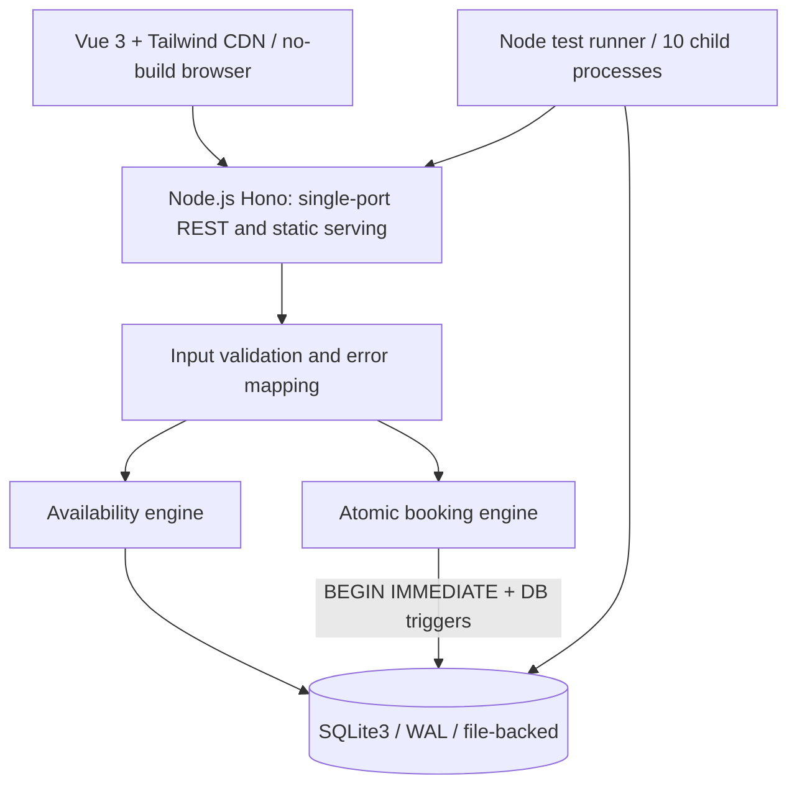
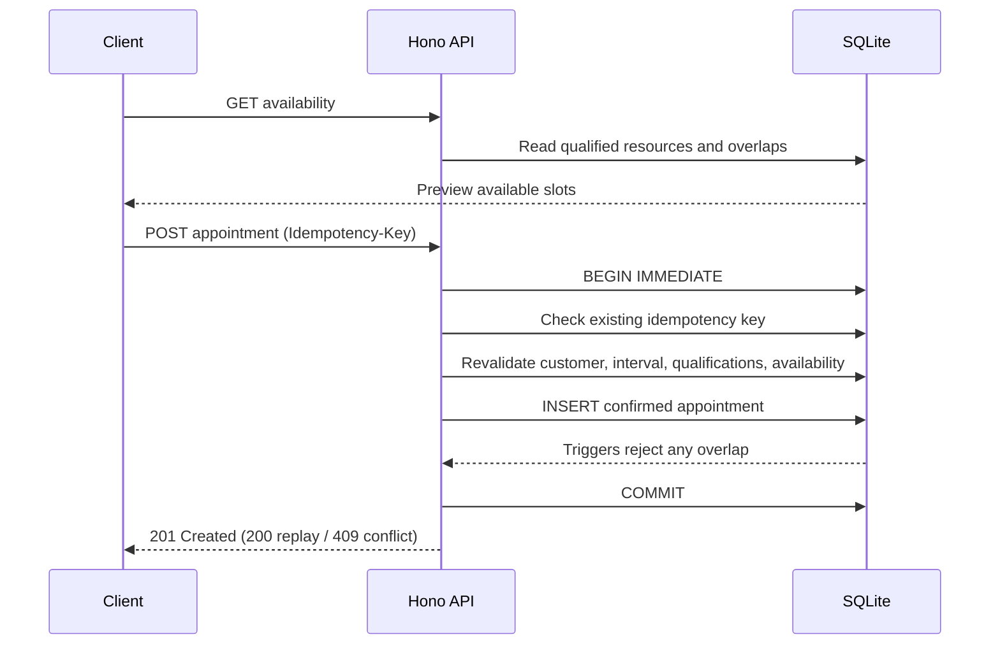

# System Design — Unified Service Scheduler

## Acceptance contract
A-1: Request a service appointment using customer/vehicle/dealership/service/time. A-2: Check **both** a qualified Technician and compatible ServiceBay for the **entire** appointment duration before confirming. A-3: Persist the appointment with those resource assignments.

## Deployment architecture

- **Browser** selects dealer, customer-owned vehicle, service, date and available slot; shows stored appointments and cancellation.
- **Hono** serves same-origin API and static assets, maps errors to JSON with per-request ID and structured timing logs.
- **Availability** applies dealership opening hours, technician qualification, shift and blackout restrictions, bay capability and blackout restrictions and existing confirmed appointment overlaps.
- **Booking** re-evaluates eligibility inside an immediate SQLite write transaction, atomically assigns one technician/bay pair and creates the appointment. Client preview alone does not guarantee a reservation.
- **SQLite** enforces foreign keys, indexes, unique idempotency keys, overlapping-resource rejection triggers and persistent storage.
- **Evidence layer** tests rules, HTTP contract, persistence and separate Node-process races.

## Database entities
`dealerships`, `dealership_hours`, `customers`, `vehicles`, `service_types`, `skills`, `service_type_skills`, `technicians`, `technician_skills`, `technician_shifts`, `technician_blackouts`, `service_bays`, `bay_service_types`, `bay_blackouts` and `appointments`. All persisted appointment timestamps are UTC milliseconds; dealership timezone is configured as IANA `time_zone`.

## Scheduling invariants
1. Each booking reserves exactly one qualified technician and one compatible service bay, with a full contiguous appointment interval.
2. Half-open `[start,end)` intervals overlap iff `a.start < b.end && b.start < a.end`. Adjacent appointments are valid.
3. No two **confirmed** appointments overlap on the same technician **or** service bay. INSERT/UPDATE triggers independently enforce this.
4. Service duration comes from the database, not client payload.
5. Vehicle belongs to customer, technician and bay belong to chosen dealership.
6. Idempotency key replay with identical payload returns prior result; conflicting reuse rejects.
7. A cancelled appointment remains in the database but no longer reserves resources.
8. Booking must be in the future and inside dealership-local operating hours and a complete technician shift, with no blackout.

## Transaction flow

## Observability and failure handling
Per-request correlation IDs, route names, statuses and elapsed milliseconds logged as JSON without request bodies or credentials. `/healthz` and `/readyz` exposed. Validation returns descriptive 4xx; SQLite busy returns 503; unexpected failures return sanitized 500. SQLite backups must use native online backup, not raw copying of active WAL files.

## Technology trade-offs
Hono keeps service lightweight. `better-sqlite3` supplies synchronous immediate transactions; SQLite allows only one writer at a time, which is acceptable for this single-host assessment but not a distributed multi-host architecture. The no-build browser app loads Vue and Tailwind from public CDNs, so it needs first-load internet connectivity. Tailwind Play CDN is development/demo only.

## AI collaboration and verification
AI-assisted design and coding were directed by three source acceptance criteria. Independent tests discovered and corrected a Sunday fixture date and an invalid initial assumption that a client UTC timestamp must use the dealership's local offset. Multi-process SQLite races, HTTP status contracts, raw trigger checks and backup integrity are executable evidence. Manual browser usability and production security are not inferred from unit tests.

## Reviewer reproducibility and boundaries

Run `npm ci`, `npm test`, and `npm run test:concurrency` from the repository root. The published [Live Scheduling Lab](../notebooks/Keyloop-Scenario-A-Scheduling-Lab-Live.ipynb) checks out public source into a disposable workspace, seeds synthetic SQLite data, and starts a temporary single-host HTTP/tunnel session. Simulation databases are separate from its ordinary appointment database.

The public demo write token protects demonstration writes, but it is not production authentication. Cloudflare Quick Tunnel URLs are temporary. Browser automation and axe checks cannot substitute for human screen-reader testing or verification on physical mobile devices. The system is not intended for multi-host SQLite writes.
